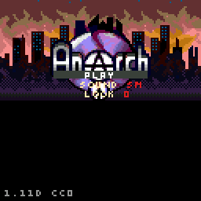

# Anarch for CircuitMess Bit

[](https://github.com/dkorunic/Anarch-Bit/actions/workflows/build.yml)

Standalone ESP-IDF firmware that runs only Anarch on a CircuitMess Bit
(all revisions; Bit 3.0 = hardware revision 3/4, read from efuse).

**[Install from your browser](https://dkorunic.github.io/Anarch-Bit/)**: desktop Chrome, Edge
or Opera, a USB-C cable, one click. Nothing to install.



What the Bit's 128x128 screen shows, at 2x size and 20 FPS: rendered on the PC by
`tools/make_demo.sh` from the same patched sources and settings as the firmware, playing
a scripted run (`tools/demo.cpp`).

- `anarch/`: git submodule, [szymor/anarch](https://github.com/szymor/anarch), kept unmodified.
- `mods/`: Anarch mods (`NN-name.diff`). At build time the Anarch sources are copied to
  `build/esp-idf/main/anarch/` and every `mods/*.diff` is applied in name order, with no
  fuzz: a mod that doesn't fit exactly fails the build instead of landing in the wrong place.
  The next `idf.py build` after any change re-patches and recompiles.

Mods 01-11 are from Anarch's `mods/` (the author's "consoomer edition" set, minus `crt`
and `terminal_messages`), rebased onto the submodule's commit so they stack exactly; the
original upstream diffs conflict with each other. 12 and 13 are ours.

| Mod | Does |
|---|---|
| 01 smooth_monsters | monsters move smoothly instead of square by square |
| 02 smooth_text | rounder font |
| 03 better_hud | nicer HUD bar with a compass |
| 04 floor_texture | textured floor (the most common floor height in each level) |
| 05 full_zbuffer | sprites no longer show through walls |
| 06 sprite_flipper | some sprites flip to look animated |
| 07 weapon_swing | weapon sways while walking |
| 08 particle_effects | particles from shots and explosions |
| 09 quicksave | `qsave` / `qload` in the game menu |
| 10 hd | 64x64 textures instead of 32x32 |
| 11 movement_inertia | smoother acceleration / stopping |
| 12 quicksave_store | quicksaves survive power-off (see below); quickload keeps current unlocked levels and settings |
| 13 parallel_columns | lets the ray casting's columns run on both cores (see Performance) |

A new or updated mod must apply on top of the previous ones: make it against the output of
`tools/patch_anarch.sh <dir>`, number it after the others, and run `tools/smoke_test.sh`.

## Flash a prebuilt release

The easiest way is the [browser installer](https://dkorunic.github.io/Anarch-Bit/) (ESP Web
Tools, built on Espressif's esptool-js; needs desktop Chrome, Edge or Opera for Web Serial).
It always flashes the latest release's complete image, which erases saved progress.

Every `v*` tag also gets a [release](https://github.com/dkorunic/Anarch-Bit/releases) with
two files built by CI:

- `anarch-bit-merged.bin`: the complete image for a first install, written at `0x0`. It also
  erases saved progress (unlocked levels, settings).
- `anarch-bit.bin`: the app alone, written at `0x10000`, to update an earlier release while
  keeping saved progress. A quicksave is discarded by any different build either way.

With [esptool](https://docs.espressif.com/projects/esptool/) (`pip install esptool`) and
the Bit connected over USB:

```shell
esptool.py --chip esp32s3 -p /dev/ttyACM0 write_flash 0x0 anarch-bit-merged.bin   # first install
esptool.py --chip esp32s3 -p /dev/ttyACM0 write_flash 0x10000 anarch-bit.bin      # update
```

The port is `COMx` on Windows and `/dev/cu.usbmodem...` on macOS. To update while keeping
saved progress without installing esptool, use Espressif's generic
[esptool-js flasher](https://espressif.github.io/esptool-js/): Connect to the Bit, add
`anarch-bit.bin` at `0x10000`, Program.

## Build and flash

Needs ESP-IDF 5.x (tested to build with v5.4.1) and `patch`. LovyanGFX 1.2.36 is
fetched from git automatically by the IDF component manager.

```shell
git clone --recursive <this repo>   # or, in an existing clone: git submodule update --init
. ~/esp/esp-idf/export.sh
idf.py build
idf.py -p /dev/ttyACM0 flash monitor
```

This replaces the stock firmware. To go back, flash the stock image from the
[Bit-Firmware releases](https://github.com/CircuitMess/Bit-Firmware/releases).

## Controls

| Bit button | Anarch key | Does |
|---|---|---|
| D-pad | arrows | move / turn, menu navigation |
| A | A | fire, confirm |
| B | B | hold + left/right = strafe, hold + up/down = look up/down, cancel |
| Menu | C | hold + up = jump, hold + left/right (or A/B) = switch weapon, hold + down = game menu |

Saves (unlocked levels, settings) go to NVS flash. Quicksaves (game menu `qsave`, one slot)
go to their own `quicksave` flash partition and survive power-off, auto-sleep and battery
shutdown. A quicksave is only loaded by the same firmware build that wrote it (it holds
pointers into the firmware), so reflashing a different build discards it.

## Sound

Anarch's own sound effects and its bytebeat music (on/off in Anarch's settings menu, as is
sound) play as 8 kHz PCM on the buzzer: `main/audio.h` mixes them as Anarch's SDL front end
does, and a timer interrupt on the second core sets each sample as the buzzer's PWM duty
(8-bit, 156 kHz, far above hearing). While nothing plays the buzzer idles at duty 0. An
experiment: earlier versions played each effect as a frequency sweep instead.

## Taken from the stock firmware

- Boot: CircuitMess splash (`main/Splash.bmp`, from Bit-Firmware's `spiffs_image`),
  backlight fade-in and the stock boot jingle; the splash stays 2 s, then fades into the game.
- Jingles from the stock firmware: item pickup ("good" chirp), level won, player died, mixed
  in as square waves (`Chirps` in `main/audio.h`). They follow Anarch's own sound on/off setting.
- Backlight fades out before sleep/shutdown. Brightness is `Brightness` (0-100,
  default 100 like stock) in `main/main.cpp`; lower it to save battery.

## Performance

Renders at full 128x128 (`SFG_RAYCASTING_SUBSAMPLE 1`), 45 FPS, frames sent to the panel by
DMA while the next one renders; flash runs in QIO mode with enlarged caches (the HD textures
are read from flash every frame). With all mods, 60 FPS measured 93-131% CPU load in play on
a Bit 3 when everything ran on one core, hence 45.

Ideas from [CGB-Bit](https://github.com/dkorunic/CGB-Bit), not yet measured on the device:

- Both cores render: the ray casting's columns alternate between them (mod 13 and
  `renderColumns` in `main/main.cpp`). Each column only reads the level and writes its own
  pixels, so the picture is exactly the one-core picture (the smoke test checks it).
  Sprites, the HUD and the game logic stay on the first core.
- The per-column and per-pixel functions run from internal RAM (`ANARCH_IRAM` in
  `main/CMakeLists.txt`, moved by `tools/iram_hot.sh` after the build), and `main.cpp` is
  built with `-Os`.

`idf.py monitor` prints `CPU load: N% (columns on core 1: M%), F FPS` every second: the first
core's busy share (game, its columns, sending frames), the second core's columns, and the
frames drawn. If the load stays above ~100% the game can't keep `SFG_FPS`; set
`SFG_RAYCASTING_SUBSAMPLE 2` and/or a lower `SFG_FPS` in `main/anarch_settings.h`.

## Auto-sleep

Like the stock default, after 2 minutes without any button held the Bit goes to deep
sleep (`SleepMs` in `main/main.cpp`). 10 s before that the screen dims as a warning;
any button brings it back. Toggle the power switch to start again. Progress
inside the current level is lost; unlocked levels are kept.

## Low battery

Below 15% a small red battery blinks in the top-right corner (as stock blinks its empty
battery icon). Otherwise same as stock firmware: below ~5% at power-on the Bit goes straight to deep sleep;
while playing, at ~1% it shows "Battery critical, shutting down" for 6 s, then
deep-sleeps. Charge it and toggle the power switch to start again.

## Development

PC tools, needing a C++20 compiler, `patch` and (for the GIF) Python with Pillow, but not
ESP-IDF. Run them from a normal shell: the ESP-IDF shell's Python has no Pillow.

- `tools/patch_anarch.sh <dir>`: writes the patched Anarch tree the firmware is built from
  (the build runs it too).
- `tools/smoke_test.sh`: plays all 10 levels of the patched game with random input under
  ASan/UBSan (deaths, a forced win per level, level transitions), rendering on two threads
  as the firmware's two cores do, and checks the quicksave behaviour of mod 12, that frames
  drawn on two threads match one-thread frames exactly, and the PCM mixer; about a minute.
- `tools/make_demo.sh`: regenerates `demo.gif`. The run is scripted in frames, so changes
  that affect movement or aiming may need `tools/demo.cpp` retuned.
- `web/build.sh <dir> <anarch-bit-merged.bin> <version>`: assembles the browser installer
  site (page, manifest, firmware, and ESP Web Tools checked against a pinned hash and served
  from the site itself, no CDN).

CI (`.github/workflows/build.yml`) runs the smoke test on every push and pull request,
then builds the firmware in the `espressif/idf:v5.4.1` image; on `v*` tags it attaches
both images to a release and deploys the browser installer to GitHub Pages.

## License

[CC0 1.0](LICENSE) (public domain), like Anarch itself, for everything in this repository
except `main/Splash.bmp`: the CircuitMess logo, taken from
[Bit-Firmware](https://github.com/CircuitMess/Bit-Firmware) and remaining CircuitMess's.
Dependencies keep their own licenses: Anarch and its mods (submodule, CC0) and
LovyanGFX (fetched at build time, FreeBSD license).
